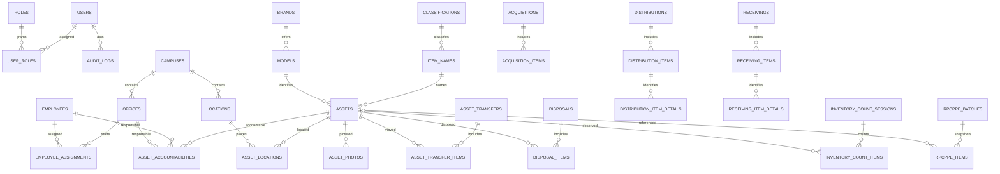

# SAPMS schema proposal

**Scope:** design only. This document proposes a normalized MySQL schema for durable property and supply management. No migrations, models, panel resources, or database operations are included in Stage 1.

## Conventions

- Use InnoDB, `bigint unsigned` primary keys, UTC timestamps, and `created_at` / `updated_at` on mutable tables. Soft-deletable master and business tables use `deleted_at`; lookup and identity rows also have `is_active` where users need to retire them without deleting history. Never hard-delete referenced business records.
- `created_by` and `updated_by` are nullable `bigint unsigned` FKs to `users.id`, `ON DELETE SET NULL`; audit history preserves actor snapshots if an account is later anonymized or removed. Business references use `RESTRICT` on delete. Child rows owned by a draft header may cascade only if policy permits; the safer proposal is `RESTRICT` and explicit cancellation/archiving.
- IDs are internal surrogate keys. Foreign keys are indexed. Add `legacy_id bigint unsigned NULL UNIQUE` on importable entities and transactions. Use nullable `legacy_*` snapshots only for imported unresolved references; never use these in place of valid FKs. Legacy snapshots are text and carry the original value for reconciliation.
- PHP/application validation enforces cross-column rules that MySQL `CHECK` constraints cannot reliably express across tables. Use `CHECK` constraints for positive quantities and nonnegative amounts where supported. Status fields are constrained `varchar` values backed by application enums and database `CHECK` constraints; do not add lookup tables for fixed workflow states. Configurable categories and classifications are reference tables.
- `decimal(15,2)` for currency amounts; `decimal(12,4)` for unit costs; `decimal(12,3)` for measured quantities; GPS latitude/longitude use `decimal(10,7)` / `decimal(10,7)`. Store images as private disk paths and metadata, never blobs.
- A `legacy_id` unique index permits multiple NULL values in MySQL. It is appropriate on rows that may be imported; do not add it to high-volume detail rows unless an old counterpart is importable.
- All table names below are plural snake_case. `FK` rules are stated explicitly. `RESTRICT` prevents referenced rows from being removed; archive with `is_active` or soft delete instead.

## Identity, authorization, configuration, and audit

| Table | Columns and rules | Purpose |
|---|---|---|
| `users` | Standard Laravel fields: `id`, `name varchar(255)`, `email varchar(255) UNIQUE`, `email_verified_at timestamp NULL`, `password varchar(255)`, `remember_token varchar(100) NULL`, timestamps; add `is_active boolean NOT NULL DEFAULT true`, `deleted_at timestamp NULL`, `legacy_id bigint unsigned NULL UNIQUE`. | Panel identities; Laravel bcrypt hashing remains the password mechanism. |
| `roles` | `id`, `code varchar(60) UNIQUE`, `name varchar(120) UNIQUE`, `description text NULL`, `is_active boolean`, timestamps, nullable `created_by`, `updated_by` FKs to users `SET NULL`. Seed the named roles from the product brief. | Stable role definitions with role codes used in policy. |
| `user_roles` | `id`, `user_id` FK users `RESTRICT`, `role_id` FK roles `RESTRICT`, `assigned_by` FK users `SET NULL`, `assigned_at timestamp`, `revoked_at timestamp NULL`, timestamps; unique `(user_id, role_id, revoked_at)` is insufficient for multiple NULLs, so enforce one current grant with a generated nullable `active_user_role_key` or transaction-level validation; index `(user_id, revoked_at)`, `(role_id, revoked_at)`. | Role assignment history; retain revoked grants. |
| `system_settings` | `id`, `key varchar(120) UNIQUE`, `value text NULL`, `type varchar(30) CHECK in ('string','integer','boolean','json')`, `description text NULL`, timestamps, `updated_by` FK users `SET NULL`. | Administrator-managed configuration; no secrets stored here. |
| `audit_logs` | `id`, `occurred_at timestamp(6)`, `actor_user_id` FK users `SET NULL`, `actor_name_snapshot varchar(255) NULL`, `action varchar(40) CHECK in ('created','updated','deleted','restored','approved','rejected','issued','received','transferred','disposed','login','role_changed','exported')`, `subject_type varchar(160)`, `subject_id bigint unsigned NULL`, `request_id varchar(64) NULL`, `ip_address varchar(45) NULL`, `metadata json NULL`, `before_values json NULL`, `after_values json NULL`; indexes `(subject_type,subject_id,occurred_at)`, `(actor_user_id,occurred_at)`, `(occurred_at)`. No `updated_at`; append-only enforced by DB permissions/application policy. | Single immutable audit stream. Avoid credentials, secrets, and unnecessary personal data in snapshots. |

## Reference data and organization

All reference rows are soft-retired with `is_active`; they have timestamps, nullable `created_by`/`updated_by` FKs to users `SET NULL`, and nullable unique `legacy_id` when old rows may be imported. Each has `id bigint unsigned` primary key, a unique code where specified, and optional `deleted_at` only if recovery is needed; referenced codes/names are not hard deleted.

| Table | Additional columns and constraints | Purpose |
|---|---|---|
| `campuses` | `code varchar(40) UNIQUE`, `name varchar(180)`, `address text NULL`, `is_active`. | Main campus and college extensions. |
| `offices` | `campus_id` FK campuses `RESTRICT`, `code varchar(40)`, `name varchar(180)`, `parent_office_id` self-FK `RESTRICT NULL`, `is_active`; unique `(campus_id,code)`. | Organizational units and custodial offices. |
| `employees` | `employee_no varchar(60) UNIQUE NULL`, `first_name varchar(120)`, `middle_name varchar(120) NULL`, `last_name varchar(120)`, `suffix varchar(30) NULL`, `email varchar(254) NULL`, `is_active`; index `(last_name,first_name)`. | People accountable for assets. |
| `employee_assignments` | `employee_id` FK employees `RESTRICT`, `office_id` FK offices `RESTRICT`, `position_title varchar(160) NULL`, `starts_on date`, `ends_on date NULL`, `is_primary boolean`, timestamps; indexes `(employee_id,starts_on)`, `(office_id,starts_on)`, `CHECK ends_on IS NULL OR ends_on >= starts_on`. | Effective-dated employee office/position history. |
| `classifications` | `code varchar(40) UNIQUE`, `name varchar(160) UNIQUE`, `description text NULL`, `is_active`. | PPE / supply classification maintained by the institution. |
| `account_codes` | `code varchar(60) UNIQUE`, `name varchar(180)`, `description text NULL`, `is_active`. | Accounting object/account code. |
| `funds` | `code varchar(40) UNIQUE`, `name varchar(160)`, `fund_type varchar(40) NULL`, `is_active`. | Funding source. |
| `brands` | `name varchar(160) UNIQUE`, `is_active`. | Normalized brand choices. |
| `models` | `brand_id` FK brands `RESTRICT`, `name varchar(160)`, `is_active`; unique `(brand_id,name)`. | Brand-specific models, avoiding duplicate text and ID. |
| `item_names` | `code varchar(60) UNIQUE NULL`, `name varchar(180) UNIQUE`, `classification_id` FK classifications `RESTRICT`, `is_active`. | Canonical item descriptions. |
| `unit_of_measures` | `code varchar(20) UNIQUE`, `name varchar(80) UNIQUE`, `is_active`. | Standard quantity units. |
| `responsibility_codes` | `code varchar(40) UNIQUE`, `name varchar(120)`, `description text NULL`, `is_active`. | Accountability responsibility codes. |
| `suppliers` | `code varchar(40) UNIQUE NULL`, `name varchar(200)`, `address text NULL`, `contact_name varchar(160) NULL`, `email varchar(254) NULL`, `phone varchar(40) NULL`, `is_active`. | Vendors/donors and delivery counterparties. |
| `locations` | `campus_id` FK campuses `RESTRICT`, `office_id` FK offices `RESTRICT NULL`, `code varchar(60)`, `name varchar(180)`, `location_type varchar(30) CHECK in ('building','room','storage','other')`, `parent_location_id` self-FK `RESTRICT NULL`, `latitude decimal(10,7) NULL`, `longitude decimal(10,7) NULL`, `is_active`; unique `(campus_id,code)`, indexes on office and parent. | Reusable physical location, with optional GPS. |

## Assets, acquisition, accountability, and location history

An asset row represents a **tracked property item identity**. Purchase/donation lines are recorded separately. Repeated identical equipment can be represented by distinct asset rows so every property number, serial, QR tag, location, and accountability history remains traceable. Whether consumable stock belongs here is unresolved in `QUESTIONS.md`.

| Table | Columns and rules | Purpose |
|---|---|---|
| `assets` | `id`, `property_number varchar(80) UNIQUE NOT NULL`, `qr_tag varchar(100) UNIQUE NULL`, `serial_number varchar(160) NULL` index (not unique by default; some classes reuse/omit serials), `item_name_id` FK item_names `RESTRICT`, `classification_id` FK classifications `RESTRICT`, `brand_id` FK brands `RESTRICT NULL`, `model_id` FK models `RESTRICT NULL`, `unit_of_measure_id` FK units `RESTRICT`, `quantity decimal(12,3) NOT NULL CHECK > 0`, `unit_cost decimal(12,4) NOT NULL CHECK >= 0`, `acquisition_cost decimal(15,2) NOT NULL CHECK >= 0`, `acquisition_date date NOT NULL`, `condition varchar(30) CHECK in ('excellent','very_good','good','fair','poor','unserviceable')`, `asset_status varchar(30) CHECK in ('active','in_storage','in_transfer','disposed','lost','written_off')`, `is_active boolean`, `legacy_id bigint unsigned NULL UNIQUE`, nullable `legacy_classification`, `legacy_employee`, `legacy_responsibility_code`, timestamps, `created_by`/`updated_by` FKs users `SET NULL`, `deleted_at`; indexes on item, classification, status, date, brand/model. Validate acquisition_cost = rounded quantity × unit_cost at application level unless an approved adjustment/discount is explicitly represented. | Current tracked property identity and core valuation. |
| `acquisitions` | `id`, `acquisition_no varchar(80) UNIQUE`, `acquisition_type varchar(20) CHECK in ('purchase','donation')`, `supplier_id` FK suppliers `RESTRICT NULL`, `reference_no varchar(100) NULL`, `document_date date NULL`, `received_on date NULL`, `fund_id` FK funds `RESTRICT`, `account_code_id` FK account_codes `RESTRICT`, `remarks text NULL`, `status varchar(20) CHECK in ('draft','received','cancelled')`, `legacy_id` nullable unique, timestamps, created/updated user FKs `SET NULL`, `deleted_at`. | Acquisition document header, separated from individual assets. |
| `acquisition_items` | `id`, `acquisition_id` FK acquisitions `RESTRICT`, `asset_id` FK assets `RESTRICT NULL` (nullable until received/registered), `item_name_id` FK item_names `RESTRICT`, `unit_of_measure_id` FK units `RESTRICT`, `quantity decimal(12,3) CHECK > 0`, `unit_cost decimal(12,4) CHECK >= 0`, `line_total decimal(15,2) CHECK >= 0`, `description text NULL`, timestamps, unique nullable `legacy_id`; index acquisition and asset. | Line-level quantities and prices; allows one document to create multiple tracked assets. |
| `asset_accountabilities` | `id`, `asset_id` FK assets `RESTRICT`, `office_id` FK offices `RESTRICT`, `employee_id` FK employees `RESTRICT NULL`, `responsibility_code_id` FK responsibility_codes `RESTRICT`, `accountability_status varchar(24) CHECK in ('office','employee','in_storage','pending_acknowledgment')`, `starts_at datetime`, `ends_at datetime NULL`, `source_type varchar(80) NULL`, `source_id bigint unsigned NULL`, `notes text NULL`, timestamps, created user FK `SET NULL`; index `(asset_id,starts_at)`, `(employee_id,ends_at)`, `(office_id,ends_at)`. Enforce at most one current row per asset in application/transaction. | Effective-dated responsibility with retained history. |
| `asset_locations` | `id`, `asset_id` FK assets `RESTRICT`, `location_id` FK locations `RESTRICT`, `starts_at datetime`, `ends_at datetime NULL`, `source_type varchar(80) NULL`, `source_id bigint unsigned NULL`, `notes text NULL`, timestamps, created user FK `SET NULL`; index `(asset_id,starts_at)`, `(location_id,ends_at)`. Enforce one current location per asset. | Effective-dated location history, decoupled from accountability. |
| `asset_photos` | `id`, `asset_id` FK assets `RESTRICT`, `disk varchar(40)`, `path varchar(500)`, `original_name varchar(255) NULL`, `mime_type varchar(120)`, `size_bytes bigint unsigned`, `caption varchar(255) NULL`, `sort_order smallint unsigned DEFAULT 0`, `uploaded_by` FK users `SET NULL`, timestamps; index `(asset_id,sort_order)`. | Private image metadata and storage pointers. |

## Transfers, disposals, distributions, receiving, and forms

Workflow statuses are fixed enums validated in application and with `CHECK`; transitions are logged. Do not overwrite finalized documents: cancel/reverse with a linked follow-up transaction.

| Table | Columns and rules | Purpose |
|---|---|---|
| `asset_transfers` | `id`, `transfer_no varchar(80) UNIQUE`, `requested_by` FK users `SET NULL`, `from_office_id` FK offices `RESTRICT`, `to_office_id` FK offices `RESTRICT`, `from_location_id`/`to_location_id` FK locations `RESTRICT NULL`, `requested_on date`, `effective_on date NULL`, `status varchar(24) CHECK in ('draft','submitted','approved','rejected','in_transit','received','cancelled')`, `approved_by` FK users `SET NULL`, `approved_at datetime NULL`, `received_by` FK users `SET NULL`, `received_at datetime NULL`, `reason text`, `remarks text NULL`, `legacy_id` nullable unique, timestamps, updated/created user FKs `SET NULL`, `deleted_at`; indexes on status/date/offices. | Transfer request and approval/receipt workflow header. |
| `asset_transfer_items` | `id`, `asset_transfer_id` FK transfers `RESTRICT`, `asset_id` FK assets `RESTRICT`, `condition_before` and `condition_after` same constrained condition values nullable, `notes text NULL`, timestamps; unique `(asset_transfer_id,asset_id)`, unique nullable `legacy_id`. | Assets included in a transfer. |
| `disposals` | `id`, `disposal_no varchar(80) UNIQUE`, `requested_by` FK users `SET NULL`, `requested_on date`, `disposal_method varchar(30) CHECK in ('sale','trade_in','donation','destruction','other')`, `reason text`, `status varchar(24) CHECK in ('draft','submitted','approved','rejected','completed','cancelled')`, `approved_by` FK users `SET NULL`, `approved_at datetime NULL`, `completed_by` FK users `SET NULL`, `completed_at datetime NULL`, `proceeds decimal(15,2) NULL CHECK >= 0`, `remarks text NULL`, `legacy_id` nullable unique, timestamps, created/updated user FKs `SET NULL`, `deleted_at`. | Approval and completion record for disposal. |
| `disposal_items` | `id`, `disposal_id` FK disposals `RESTRICT`, `asset_id` FK assets `RESTRICT`, `quantity decimal(12,3) CHECK > 0`, `condition varchar(30)` constrained condition, `appraised_value decimal(15,2) NULL CHECK >= 0`, `notes text NULL`, timestamps; unique `(disposal_id,asset_id)`. | Property items disposed; asset status changes only on completion. |
| `distributions` | `id`, `distribution_no varchar(80) UNIQUE`, `recipient_office_id` FK offices `RESTRICT`, `recipient_employee_id` FK employees `RESTRICT NULL`, `issued_by` FK users `SET NULL`, `issued_on date NULL`, `status varchar(24) CHECK in ('draft','approved','issued','cancelled')`, `approved_by` FK users `SET NULL`, `approved_at datetime NULL`, `remarks text NULL`, `legacy_id` nullable unique, timestamps, created/updated user FKs `SET NULL`. | Grouped issue of equipment or (if approved in open questions) supplies. |
| `distribution_items` | `id`, `distribution_id` FK distributions `RESTRICT`, `asset_id` FK assets `RESTRICT NULL`, `item_name_id` FK item_names `RESTRICT`, `unit_of_measure_id` FK units `RESTRICT`, `quantity decimal(12,3) CHECK > 0`, `unit_cost decimal(12,4) NULL CHECK >= 0`, `line_total decimal(15,2) NULL CHECK >= 0`, timestamps; indexes distribution/asset; nullable unique `legacy_id`. | Distribution details; nullable asset supports bulk stock only if stock module is approved. |
| `distribution_item_details` | `id`, `distribution_item_id` FK distribution_items `RESTRICT`, `asset_id` FK assets `RESTRICT`, `condition varchar(30)` constrained, `notes text NULL`, timestamps; unique `(distribution_item_id,asset_id)`. | Specific serialized assets represented by an aggregate line. |
| `receivings` | `id`, `receiving_no varchar(80) UNIQUE`, `acquisition_id` FK acquisitions `RESTRICT NULL`, `supplier_id` FK suppliers `RESTRICT NULL`, `delivery_reference varchar(100) NULL`, `delivered_on date NULL`, `received_by` FK users `SET NULL`, `status varchar(20) CHECK in ('draft','received','rejected','cancelled')`, `remarks text NULL`, timestamps, created/updated user FKs `SET NULL`. | Physical delivery acceptance, distinct from acquisition accounting. |
| `receiving_items` | `id`, `receiving_id` FK receivings `RESTRICT`, `item_name_id` FK item_names `RESTRICT`, `unit_of_measure_id` FK units `RESTRICT`, `quantity_expected decimal(12,3) NULL`, `quantity_received decimal(12,3) CHECK >= 0`, `condition varchar(30)` constrained, `notes text NULL`, timestamps; nullable unique `legacy_id`. | Received quantities and discrepancies. |
| `receiving_item_details` | `id`, `receiving_item_id` FK receiving_items `RESTRICT`, `asset_id` FK assets `RESTRICT NULL`, `serial_number varchar(160) NULL`, `condition varchar(30)` constrained, `notes text NULL`, timestamps; index receiving item/asset. | Per-unit serial and inspection detail for serialized receipts. |
| `document_sequences` | `id`, `document_type varchar(40)`, `campus_id` FK campuses `RESTRICT NULL`, `fiscal_year smallint unsigned`, `last_number bigint unsigned`, timestamps; unique `(document_type,campus_id,fiscal_year)`. | Atomic numbering counters; final format/prefix awaits policy answer. |

## Physical inventory and RPCPPE

| Table | Columns and rules | Purpose |
|---|---|---|
| `inventory_count_sessions` | `id`, `session_no varchar(80) UNIQUE`, `name varchar(180)`, `campus_id` FK campuses `RESTRICT`, `office_id` FK offices `RESTRICT NULL`, `location_id` FK locations `RESTRICT NULL`, `opened_on date`, `closed_on date NULL`, `status varchar(20) CHECK in ('draft','open','reconciled','closed','cancelled')`, `opened_by`/`closed_by` FKs users `SET NULL`, `notes text NULL`, `legacy_id` nullable unique, timestamps, created/updated user FKs `SET NULL`. | Defined physical count scope and lifecycle. |
| `inventory_count_items` | `id`, `session_id` FK sessions `RESTRICT`, `asset_id` FK assets `RESTRICT`, `expected_location_id` FK locations `RESTRICT NULL`, `observed_location_id` FK locations `RESTRICT NULL`, `expected_employee_id` FK employees `RESTRICT NULL`, `observed_employee_id` FK employees `RESTRICT NULL`, `expected_condition` and `observed_condition` constrained nullable, `count_status varchar(20) CHECK in ('found','missing','extra','damaged','unverified')`, `counted_at datetime NULL`, `counted_by` FK users `SET NULL`, `variance_notes text NULL`, `resolved_at datetime NULL`, timestamps; unique `(session_id,asset_id)`, index `(session_id,count_status)`. | Snapshot and variance for each expected asset. |
| `rpcppe_batches` | `id`, `batch_no varchar(80) UNIQUE`, `reporting_date date`, `campus_id` FK campuses `RESTRICT`, `status varchar(20) CHECK in ('draft','submitted','superseded','cancelled')`, `generated_by` FK users `SET NULL`, `generated_at datetime NULL`, `supersedes_id` self-FK `RESTRICT NULL`, `file_path varchar(500) NULL`, `notes text NULL`, timestamps, legacy_id nullable unique. | Immutable report snapshot header; corrected reports supersede prior batches. |
| `rpcppe_items` | `id`, `batch_id` FK rpcppe_batches `RESTRICT`, `asset_id` FK assets `RESTRICT NULL`, `property_number_snapshot varchar(80)`, `description_snapshot varchar(255)`, `date_acquired_snapshot date NULL`, `acquisition_cost_snapshot decimal(15,2)`, `location_snapshot varchar(255) NULL`, `accountability_snapshot varchar(255) NULL`, `condition_snapshot varchar(30) NULL`, `remarks text NULL`, timestamps; index batch and asset. | Point-in-time report lines so later edits do not rewrite submitted RPCPPE. |

## Key relationships and normalization decisions

- Asset identity, acquisition document, current responsibility, and current location are separate. The acquisition tables preserve purchase/donation documents; accountability and location histories retain temporal transitions without bloating `assets`.
- Brand/model/item name are reference-only foreign keys. Unmatched imported source strings belong in nullable legacy snapshots and are reconciled into references; do not duplicate normal names on the asset.
- Transfers and disposals are request headers plus item rows. Approval and completion metadata is explicit; current asset accountability/location/status is updated transactionally and histories point back to the source document.
- Receiving is separated from acquisition because a purchase order/document and physical arrival are distinct events and may have shortages, rejections, or split deliveries. The precise linkage and document flow require confirmation.
- Inventory count rows snapshot observed versus expected facts. RPCPPE batch rows are snapshots because a report must remain reproducible after the live asset changes.
- User/role joins keep assignment history. Role and user active checks are both mandatory at authorization time; policies deny by default.

## ER summary

